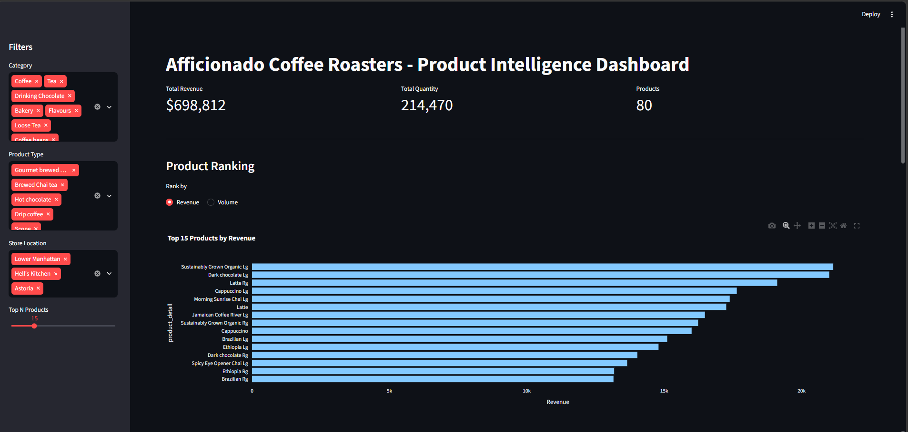
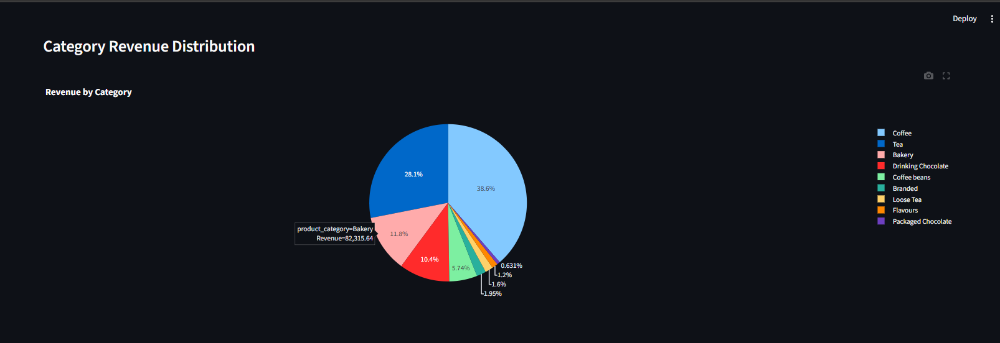

# afficionado-coffee-dashboard

Interactive product intelligence dashboard built with Streamlit for the Afficionado Coffee Roasters.

## Insights provided by the dashboard

- Total sales revenue and quantity sold
- Most successful products based on revenue and sales quantity
- Revenue breakdown based on categories
- Scatter plot of popularity vs. revenue
- Performance table of products

## Technologies used

- Python
- Streamlit
- Pandas
- Plotly
- Excel (for data cleaning)

## Features

- Filter by Category
- Filter by Product Type
- Filter by Store Location
- Top N products slider

## Screenshots






## How to run the app

1. Install dependencies
   ```
   pip install streamlit pandas plotly openpyxl
   streamlit run app.py
