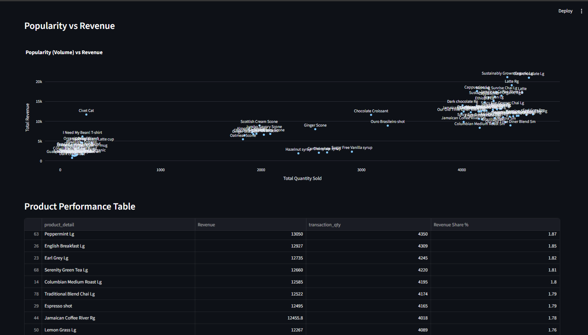

# afficionado-coffee-dashboard

Interactive product intelligence dashboard built with Streamlit for the Afficionado Coffee Roasters.

## Problem Statement

Afficionado Coffee Roasters has information on their product sales but lacks visibility in relation to knowing which products generate their income and the distribution of sales within each category. Lack of analysis of their product portfolio makes it hard to determine their best performing products and contribution from various categories.

## Objectives

### Primary Objectives
- Identify top-selling and least-selling products
- Quantify revenue contribution by product and category
- Measure revenue concentration across the menu

### Secondary Objectives
- Support menu simplification and optimization
- Identify high-impact hero products
- Highlight low-performing products for review or redesign

## Key Learnings

### Best and worst performing products
- Products with highest revenue contributions: Sustainably Grown Organic Lg, Dark Chocolate Lg, and Latte Rg.
- There are several products which have very low revenue contribution and can be subject to review.

### Revenue contribution of products and categories
- Contribution from Coffee products is about 39% of total revenue.
- Contribution from Tea products is about 28% of total revenue.
- Together, Coffee and Tea products contribute to more than two-thirds of total revenue.

### Revenue concentration
- 42 products (out of 80) account for approximately 80% of total revenue.
- Rest 38 products contribute to only 20% of revenue.
- Revenue is somewhat concentrated rather than highly concentrated among a few products.

### Learnings from menu optimization exercise
- Hero products: Sustainably Grown Organic Lg, Dark Chocolate Lg, and Latte Rg
- There are several products with low revenue contribution and need to be reviewed for menu optimization.

## Technologies used

- Python
- Streamlit
- Pandas
- Plotly
- Excel (for data cleaning)

## Features

- Filter by Category
- Filter by Product Type
- Filter by Store Location
- Top N products slider

## Screenshots




## How to run the app

1. Install dependencies
   ```
   pip install streamlit pandas plotly openpyxl
   streamlit run app.py
